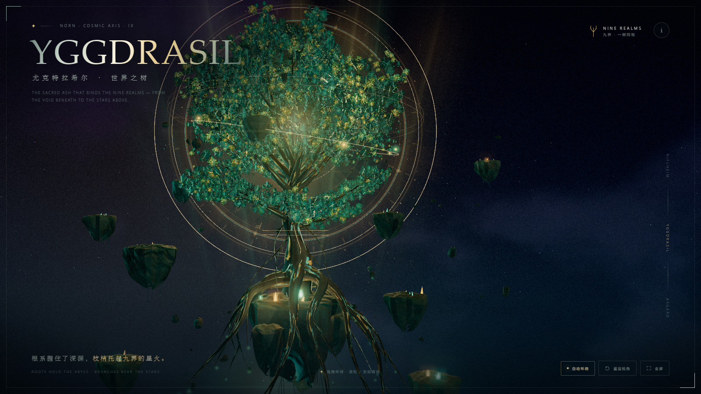
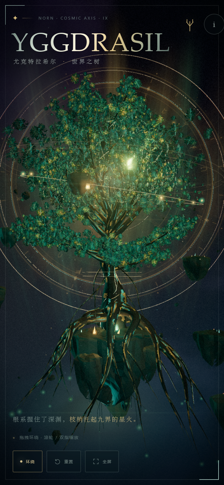

# Yggdrasil · 世界树

一个完全程序化生成的交互式三维世界树场景。巨大的扭曲树干、向虚空延伸的根系、层叠发光的树冠、浮空岛、符文光环、星尘与程序化星云，全部用 Three.js 实时构建。

## Live

**https://zyxszml.github.io/yggdrasil-world-tree/**



## Interaction

- 拖拽：环绕
- 滚轮 / 双指：缩放
- 方向键：环绕；`+` / `−`：缩放
- `Space`：暂停 / 恢复自动环绕
- `R`：重置视角；`F`：全屏
- 移动端自动使用更轻的几何、光照与纹理档位

## Technical Notes

- Three.js `0.170.0`，通过 import map 从 unpkg 加载，无构建步骤
- 单文件 `index.html`，内联 CSS / JS；树皮、叶片、岩石、符文、光晕等纹理均由 Canvas 程序化生成
- 自定义风动叶片材质、树皮发光裂隙、相机朝向符文光环、浮空岛与星尘系统
- 为移动端降低纹理生成分辨率与灯光数量，并关闭实时阴影贴图更新
- 支持键盘导航、焦点陷阱、`prefers-reduced-motion`，CDN 加载失败时会给出可恢复的错误提示

## Preview



## Credits

视觉语言参考（仅作研究，未加载为外部贴图）：Fillder、Jarol-Tilap、DVKtheartist、Dwoll、StockCake。完整链接见页面内 “关于 / 参考” 面板。

## Local Run

```bash
python -m http.server 8123
# http://127.0.0.1:8123/index.html
```

页面依赖可访问 `unpkg.com` 的 CDN。
